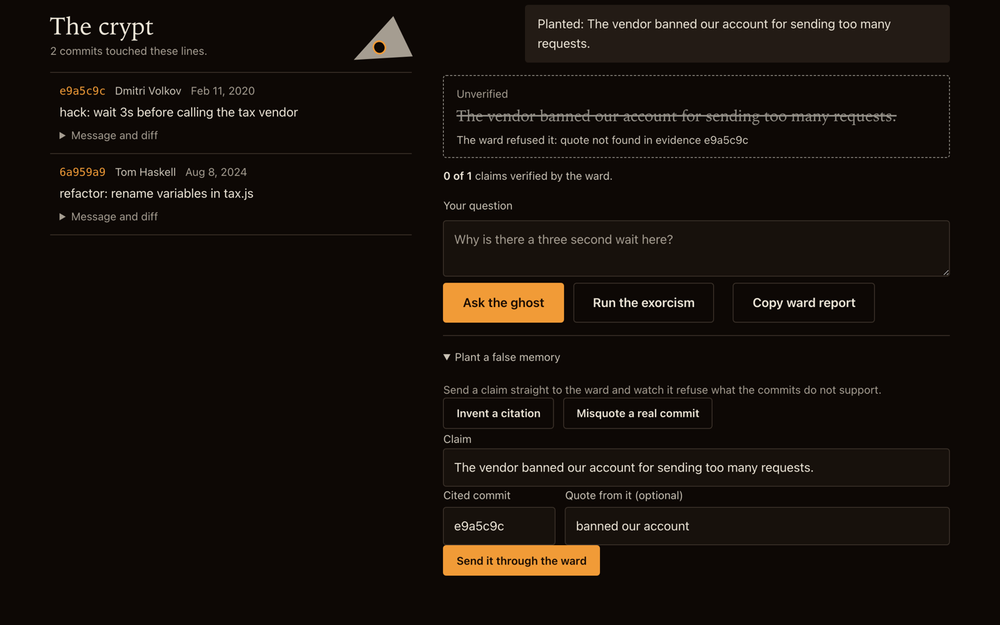

# Séance

**Ask the one who wrote it.** Point Séance at a line of code. It reads that line's git history and lets the original author's ghost answer, but only from the commits. A deterministic ward checks every claim: a commit hash that does not exist, or a quote that is not in the commit, is struck out and counted ("4 of 5 claims verified").

Built with Kiro for Kiroween 2026 (category: Costume Contest).


## What it does

- **The crypt.** An evidence ledger from `git blame --porcelain` and `git log -L` (renames followed), with each commit's message, author, date, diff hunk, `#123` references and, for public GitHub repos with a token, the pull request text. No AI is involved in this step.
- **The ghost.** Claude answers in first person from the ledger only. Every claim is typed `memory`, `speculation` or `silence` and carries `[sha7]` citations with exact quotes.
- **The ward.** The verifier checks each citation and quote against the ledger. Rejected claims stay visible, struck through, with the reason.
- **Plant a false memory.** Send a claim straight to the ward (invent a hash, misquote a real commit) and watch it refuse.
- **The exorcism.** A haunting score (age, churn, authors gone, TODO and HACK markers, missing tests, nesting) and a refactor plan: characterization tests first, small steps, and a cited do-not-touch list for lines whose history shows a deliberate workaround. The plan passes through the same ward.

Try it on the bundled sample: `crypt`, file `legacy/tax.js`, line 7. `git blame` points at a variable rename from 2024; the ledger finds the 2020 commit that explains the 3 second wait (the vendor returns 429 within 3 seconds).

## Screens

Captured 2026-11-09 from the app running locally with a real model key (headless Chromium, 1280x800).

| Ghost answer, every claim cited (4 of 4 verified)                 | A planted false memory, refused                                        |
| ----------------------------------------------------------------- | ---------------------------------------------------------------------- |
|              |  |
| **A misquote of a real commit, refused**                          | **The exorcism: haunting score and plan**                              |
|  |                     |

Mobile (390 px): [docs/screens/390-1-landing.png](docs/screens/390-1-landing.png). Refactor steps with badges: [docs/screens/1280-6-plan.png](docs/screens/1280-6-plan.png).

## Run it

Requires Node 20+ and git.

```bash
npm install
cp .env.example .env      # add ANTHROPIC_API_KEY (or set ANTHROPIC_FIXTURE=1)
set -a; . ./.env; set +a
npm start                 # builds data/crypt, serves http://localhost:3000
npm test                  # 418 tests incl. property-based tests and real-git tests on a generated sample repo
```

Docker (Render ready): `docker build -t seance . && docker run -p 3000:3000 -e ANTHROPIC_API_KEY=... seance`. `render.yaml` is a Render blueprint.

## API

| Route                | Body                                                | Returns                                         |
| -------------------- | --------------------------------------------------- | ----------------------------------------------- |
| `POST /api/summon`   | `{repoUrl, file, startLine, endLine, githubToken?}` | `{sessionId, items[], truncated}`               |
| `POST /api/ask`      | `{sessionId, question}`                             | `{verified[], rejected[], score, voice}`        |
| `POST /api/ward`     | `{sessionId, answer}`                               | same shape; verifies any claim set              |
| `POST /api/exorcise` | `{sessionId}`                                       | `{score, signalBreakdown, plan, verifierScore}` |
| `GET /api/health`    |                                                     | `{status}`                                      |

`repoUrl` is `crypt` or a `https://github.com/owner/repo` URL. Local paths are refused unless `ALLOW_LOCAL=1`. Commit text reaches the model wrapped as untrusted data.

## Use the ward from your own agent

Séance also runs as a Model Context Protocol server on stdio. Your coding agent builds an evidence ledger for lines in a local repository, writes its own claims with exact quotes, and the ward tells it which claims are verified and which are struck, and why. No model runs inside the server: your agent is the model, and Séance is the checker.

In Kiro, add this to `.kiro/settings/mcp.json` (this repository already has it, and the `archaeologist` agent uses it):

```json
"seance": { "command": "npx", "args": ["-y", "tsx", "src/mcp/server.ts"], "env": {} }
```

Any other MCP client: start `npx -y tsx src/mcp/server.ts` (or `npm run --silent mcp`) in the Séance checkout, over stdio. `repo` is resolved against the server's working directory, so pass an absolute path when the repository is elsewhere. Plain `npm run mcp` prints npm's banner on stdout and breaks the protocol.

| Tool                  | Takes                                                                                                     | Returns                                                                                                               |
| --------------------- | --------------------------------------------------------------------------------------------------------- | --------------------------------------------------------------------------------------------------------------------- |
| `seance_summon`       | `repo` (local path, default `"."`), `file`, `startLine`, `endLine` (at most 500 lines)                    | `ledgerId`, the commits oldest first (`sha7`, `author`, `date`, `subject`, `body`, `hunk`, `suspicious`), `truncated` |
| `seance_verify`       | `ledgerId`, `claims`: each `{ kind, text, citations: [{ sha7, quote }], silenceReason? }`, 1 to 50 claims | `verified` with the words the ward found, `rejected` with the reason, `silent`, `tally`, a Markdown `report`          |
| `seance_haunting_map` | `repo` (default `"."`)                                                                                    | `map`, or `note`: a sentence saying why there is no map                                                               |

`kind` is `memory`, `speculation` or `silence`. A silence claim has a `silenceReason` and no citations (the `citations` field can be left out); it goes to `silent` and is never verified. Every entry carries `index`, the claim's position in the request.

Example on the sample crypt, `legacy/tax.js` line 7. The claim "The delay exists because the tax vendor rejects requests that arrive too close together", quoting e9a5c9c's "The vendor returns 429 if two requests from the same account land within 3 seconds", is verified, and the ward reports that it found the quote in the commit's `body`. The claim "The vendor allows short bursts, so the delay can go", quoting "support confirmed there is a burst allowance", is struck: "The quote cited from e9a5c9c is not in that commit's subject, message or diff." The report starts with `**1 of 2 claims verified**`.

With Kiro CLI 3.2.0, the default engine ran `seance_summon` and `seance_verify` from the archaeologist's `allowedTools` without asking. The V3 engine in non-interactive mode denied every seance call unless started with `--trust-all-tools`, which ran all three tools. The three runs are in [`docs/kiro-evidence/seance-mcp-session.txt`](docs/kiro-evidence/seance-mcp-session.txt).

Limits:

- Local repositories only. Remote URLs are refused; clone first.
- No model inside. The server only reads git history and checks claims.
- The ward proves that each cited sha7 names exactly one commit in the ledger, that each quote is copied exactly from one field of that commit, and that the years and ledger author names a claim mentions are supported by a cited commit. It does not prove that the claim's wording follows from the quote.
- Commit text is untrusted. Items flagged `suspicious` contain text that tries to give orders.
- Ledgers live in memory, at most 50, and are gone when the server stops. Summon again if `seance_verify` says it holds no ledger with that id.

## How Kiro was used

Everything under [`.kiro/`](.kiro) is committed: steering docs (product, tech, evidence rules, UI rules), six specs with EARS requirements, design and tasks, and the commit history references the spec task being implemented. Kiro Powers (Context7), Kiro Crew (two parallel subagents) and the fifth spec are described in [`.kiro/README.md`](.kiro/README.md), with raw session output in [`docs/kiro-evidence/`](docs/kiro-evidence). See the write-up in the submission for what worked, what did not, and where Kiro's free quota ran out.

## License

MIT, see [LICENSE](LICENSE).
