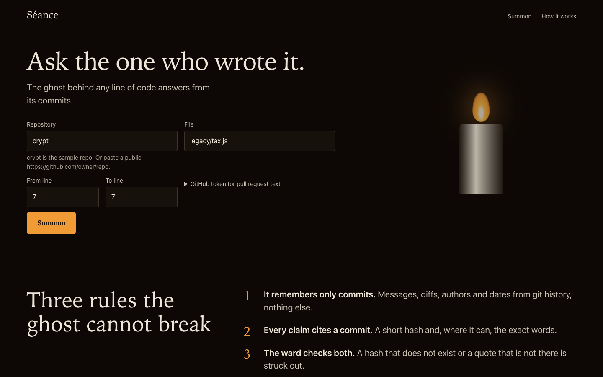

# Séance

**Ask the one who wrote it.** Point Séance at a line of code. It reads that line's git history and lets the original author's ghost answer, but only from the commits. A deterministic ward checks every claim: a commit hash that does not exist, or a quote that is not in the commit, is struck out and counted ("4 of 5 claims verified").

Built with Kiro for Kiroween 2026 (category: Costume Contest).



## What it does

- **The crypt.** An evidence ledger from `git blame --porcelain` and `git log -L` (renames followed), with each commit's message, author, date, diff hunk, `#123` references and, for public GitHub repos with a token, the pull request text. No AI is involved in this step.
- **The ghost.** Claude answers in first person from the ledger only. Every claim is typed `memory`, `speculation` or `silence` and carries `[sha7]` citations with exact quotes.
- **The ward.** The verifier checks each citation and quote against the ledger. Rejected claims stay visible, struck through, with the reason.
- **Plant a false memory.** Send a claim straight to the ward (invent a hash, misquote a real commit) and watch it refuse.
- **The exorcism.** A haunting score (age, churn, authors gone, TODO and HACK markers, missing tests, nesting) and a refactor plan: characterization tests first, small steps, and a cited do-not-touch list for lines whose history shows a deliberate workaround. The plan passes through the same ward.

Try it on the bundled sample: `crypt`, file `legacy/tax.js`, line 7. `git blame` points at a variable rename from 2024; the ledger finds the 2020 commit that explains the 3 second wait (the vendor returns 429 within 3 seconds).

## Run it

Requires Node 20+ and git.

```bash
npm install
cp .env.example .env      # add ANTHROPIC_API_KEY (or set ANTHROPIC_FIXTURE=1)
set -a; . ./.env; set +a
npm start                 # builds data/crypt, serves http://localhost:3000
npm test                  # 286 tests incl. property-based tests and a real-git integration test
```

Docker (Render ready): `docker build -t seance . && docker run -p 3000:3000 -e ANTHROPIC_API_KEY=... seance`. `render.yaml` is a Render blueprint.

## API

| Route | Body | Returns |
| ----- | ---- | ------- |
| `POST /api/summon` | `{repoUrl, file, startLine, endLine, githubToken?}` | `{sessionId, items[], truncated}` |
| `POST /api/ask` | `{sessionId, question}` | `{verified[], rejected[], score, voice}` |
| `POST /api/ward` | `{sessionId, answer}` | same shape; verifies any claim set |
| `POST /api/exorcise` | `{sessionId}` | `{score, signalBreakdown, plan, verifierScore}` |
| `GET /api/health` | | `{status}` |

`repoUrl` is `crypt` or a `https://github.com/owner/repo` URL. Local paths are refused unless `ALLOW_LOCAL=1`. Commit text reaches the model wrapped as untrusted data.

## How Kiro was used

Everything under [`.kiro/`](.kiro) is committed: steering docs (product, tech, evidence rules, UI rules), five specs with EARS requirements, design and tasks, and the commit history references the spec task being implemented. Kiro Powers (Context7), Kiro Crew (two parallel subagents) and the fifth spec are described in [`.kiro/README.md`](.kiro/README.md), with raw session output in [`docs/kiro-evidence/`](docs/kiro-evidence). See the write-up in the submission for what worked, what did not, and where Kiro's free quota ran out.

## License

MIT, see [LICENSE](LICENSE).
